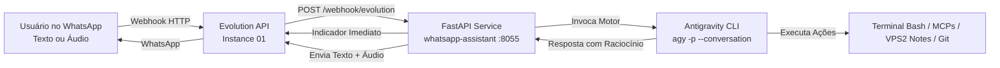

# 🤖 WhatsApp AI Assistant 2.0 (Antigravity Engine)

Microserviço em **Python (FastAPI)** que conecta o seu WhatsApp pessoal ao motor de agente autônomo **Antigravity (`agy`)** através da **Evolution API**, proporcionando um assistente de IA com permissões totais sobre a VPS, ferramentas MCP, execução de comandos bash, leitura/escrita de notas e suporte multimodal (texto, áudio e voz).

---

## 🏗️ Arquitetura do Sistema



---

## ✨ Funcionalidades Principais

* 🧠 **Motor Antigravity Nativo (`agy`):** Acesso completo à infraestrutura, arquivos, ferramentas MCP e base de conhecimento.
* 🎙️ **Suporte Multimodal Completo:**
  * **Entrada de Áudio:** Transcrição assíncrona ultrarrápida via Gemini 2.5 Flash (~1.2s).
  * **Saída de Áudio:** Síntese de voz em português para áudios de resposta no WhatsApp.
* 💬 **Preservação Contínua de Sessão:** Cada contato autorizado possui um `conversation_id` persistido em SQLite (`conversations.db`).
* ⚡ **Feedback em Tempo Real:** Reação imediata com emoji 🤖 no chat e status *"digitando..."* ou *"gravando áudio..."*.
* 🔄 **Comandos de Controle:** Envie `/reset`, `/novo` ou `/reiniciar` para iniciar uma nova linha de raciocínio.
* 🔒 **Controle de Acesso Rígido:** Apenas números autorizados em `OWNER_NUMBERS` têm permissão para interagir.
* 🛡️ **24x7 Alta Disponibilidade:** Gerenciado via `systemd` com reinício automático e monitorado por Watchdog.

---

## 🚀 Instalação Rápida (1-Click Setup)

Para instalar ou restaurar este projeto em **qualquer nova VPS**, basta clonar o repositório e executar:

```bash
git clone git@github.com:jsoj/whatsapp-ai-assistant.git /root/whatsapp-ai-assistant
cd /root/whatsapp-ai-assistant
./setup.sh
```

O script `./setup.sh` realiza automaticamente:
1. Criação do ambiente virtual Python (`venv`).
2. Instalação de todas as dependências.
3. Criação e configuração do arquivo `.env`.
4. Instalação e habilitação do serviço systemd (`whatsapp-assistant.service`).
5. Configuração de regras de firewall UFW.
6. Validação do Healthcheck local.

---

## ⚙️ Variáveis de Ambiente (`.env`)

| Variável | Descrição | Exemplo Padrão |
| :--- | :--- | :--- |
| `PORT` | Porta local do servidor FastAPI | `8055` |
| `EVOLUTION_URL` | URL base da sua Evolution API | `https://evolution.quantisia.com.br` |
| `EVOLUTION_APIKEY` | Chave de API Global da Evolution | `6CBB7DCE6D50-4851-A607-F2EC2C1580C2` |
| `EVOLUTION_INSTANCE` | Nome da instância conectada | `01` |
| `OWNER_NUMBERS` | Números autorizados (DDI+DDD+Número) | `554388597348,5543988597348` |
| `USE_ANTIGRAVITY_AGENT` | Habilita o motor Antigravity | `true` |
| `AGY_BIN_PATH` | Caminho do binário `agy` | `/root/.local/bin/agy` |
| `AGY_WORKSPACE` | Diretório raiz de trabalho do agente | `/root` |
| `AGY_EFFORT` | Nível de esforço de raciocínio | `low` |
| `AGY_TIMEOUT` | Timeout máximo por turno em segundos | `180` |
| `GEMINI_API_KEY` | Chave da API Gemini (para áudio e fallback) | `AQ.Ab8RN6...` |
| `DB_PATH` | Caminho do banco de dados SQLite | `data/conversations.db` |

---

## 📡 Configuração do Webhook na Evolution API

Para conectar a Evolution API a este assistente:

```bash
curl -X POST "https://evolution.quantisia.com.br/webhook/set/01" \
  -H "apikey: 6CBB7DCE6D50-4851-A607-F2EC2C1580C2" \
  -H "Content-Type: application/json" \
  -d '{
    "enabled": true,
    "url": "https://<seu-dominio-ou-ip>/webhook/evolution",
    "webhook_by_events": false,
    "events": ["MESSAGES_UPSERT"]
  }'
```

---

## 🛠️ Comandos de Manutenção & Diagnóstico

```bash
# Ver status do serviço
systemctl status whatsapp-assistant.service

# Ver logs ao vivo
journalctl -u whatsapp-assistant -f

# Reiniciar o serviço
systemctl restart whatsapp-assistant.service

# Rodar testes automatizados
PYTHONPATH=. ./venv/bin/pytest
```

---

## 🤖 Guia para Agentes de IA (Instruções para Automação)

Se você é um agente de IA configurando este projeto em uma nova máquina:
1. Garanta que o binário do Antigravity está instalado em `/root/.local/bin/agy` (ou no `PATH`).
2. Sincronize as credenciais e o contexto global via `git clone git@github.com:jsoj/context.git /root/context && /root/context/sync_context.sh`.
3. Execute `./setup.sh` na pasta `/root/whatsapp-ai-assistant`.
4. Verifique a resposta em `curl -s http://127.0.0.1:8055/health`.
5. Garanta que o proxy reverso (Traefik/Nginx/Caddy) esteja roteando o subdomínio apontado para a porta `8055`.
